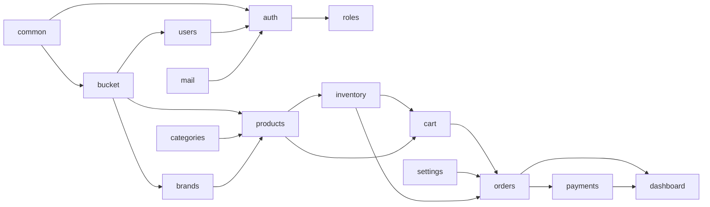

# ecommerce-be

> Lộ trình module, cập nhật 2026-10-13. Danh sách chức năng lấy từ [docs/business-requirements.md](docs/business-requirements.md).

BE mới xong phần nền và 2 module chạy được (`bucket`, `users`). Còn khoảng 12 module nghiệp vụ, chia 4 giai đoạn: Nền tảng → Catalog → Mua hàng → Vận hành, sau đó mới tới phần mở rộng.

## Tổng quan

Stack: NestJS 11, TypeORM, PostgreSQL 17, MinIO (lưu file). Hạ tầng local chạy bằng `docker compose up -d`. API chạy ở port 8080, Swagger ở `/api-docs` (basic auth).

Mỗi module nằm trong `src/modules/<tên>/`, chia thư mục theo vai trò:

| Thư mục | Chứa gì |
| --- | --- |
| `entities/` | Entity TypeORM, kế thừa `BaseUUIDEntity` (id uuid, createdAt, updatedAt) |
| `dto/` | DTO request/query, validate bằng class-validator |
| `controllers/`, `services/` | Route và nghiệp vụ |
| `constants/` | Tên bảng, giới hạn độ dài, mã message trả về (`*.response.ts`) |
| `enums/`, `utils/`, `interfaces/` | Enum trạng thái, hàm phụ trợ |

Module `common` chứa phần dùng chung: config (DB, CORS, Swagger, validate env bằng Joi), `ResponseInterceptor` bọc response thành `{ statusCode, message, messageCode, data }`, DTO phân trang, transformer `bigintToNumber` cho cột tiền VND.

## Hiện trạng

`app.module.ts` mới đăng ký `BucketModule` và `UserModule`. Module `products` mới có entity, chưa có controller, service hay `*.module.ts`, nên chưa có route nào.

| Module | Đã có | Còn thiếu |
| --- | --- | --- |
| `common` | Config, interceptor response, DTO phân trang, base entity, entity có `creatorId`/`modifierId` | Exception filter chung, guard auth |
| `bucket` | Bảng `files`; upload qua presigned URL (đơn và hàng loạt), submit file, đọc/tải/xoá; mục đích upload `user_avatar`, `product_image` | Dọn file không được submit, phân quyền theo người upload |
| `users` | CRUD `/users`, mật khẩu bcrypt, trạng thái `ACTIVE`/`BLOCKED`, avatar liên kết `files` | Vai trò, đăng nhập, sổ địa chỉ |
| `products` | Entity `Product`, `ProductVariant` (SKU, giá, giá gốc, `optionValues`), `ProductImage`; `minPrice`/`maxPrice` tính từ variant; hàm `slugify` | Module, service, controller, DTO; liên kết danh mục/thương hiệu; tồn kho |

Ngoài ra, thư mục `migrations` chưa có dù config DB đã trỏ tới; DB đang chạy bằng `DB_SYNCHRONIZE=true`. Test mới có file mẫu của Nest.

## Lộ trình

Các giai đoạn xếp theo thứ tự phụ thuộc: có auth mới khoá được API admin, có SKU và tồn kho mới làm được giỏ hàng, có đơn mới làm được thanh toán và báo cáo. Cột "Mục BR" là số mục trong `business-requirements.md`.

| Giai đoạn | Module | Phạm vi chính | Mục BR |
| --- | --- | --- | --- |
| 1. Nền tảng | `auth` | Đăng ký, xác thực email, đăng nhập (access + refresh token), quên/đặt lại mật khẩu, đăng xuất mọi thiết bị. Google để sau | 1.1 |
| 1. Nền tảng | `roles` | Vai trò customer / staff / admin, quyền theo vai trò, guard + decorator cho controller | 2.10 |
| 1. Nền tảng | `mail` | Gửi email theo template, dùng cho xác thực và quên mật khẩu | 1.9 |
| 1. Nền tảng | `users` (bổ sung) | Hồ sơ của tôi, đổi mật khẩu, sổ địa chỉ, khoá/mở khoá khách | 1.8, 2.7 |
| 2. Catalog | `categories` | Cây danh mục tối đa 3 cấp, sắp xếp, ẩn/hiện | 2.2 |
| 2. Catalog | `brands` | Tên, logo (qua `bucket`) | 2.2 |
| 2. Catalog | `products` (hoàn thiện) | API admin tạo/sửa, sinh SKU từ options, trạng thái; API public lọc, sắp xếp, tìm kiếm, chi tiết; lịch sử giá | 1.3, 1.4, 2.3 |
| 2. Catalog | `inventory` | Tồn theo SKU (thực tế / đang giữ / có thể bán), nhập hàng, điều chỉnh có lý do, lịch sử, ngưỡng cảnh báo | 2.4 |
| 3. Mua hàng | `cart` | Giỏ của guest và của tài khoản, gộp khi đăng nhập, cảnh báo đổi giá/hết hàng | 1.5 |
| 3. Mua hàng | `settings` | Phí ship, ngưỡng miễn phí ship, thời hạn thanh toán đơn, thông tin cửa hàng | 2.11 |
| 3. Mua hàng | `orders` | Checkout, giữ hàng khi đặt, máy trạng thái đơn, dòng thời gian, huỷ, ghi chú nội bộ, xuất CSV; job tự huỷ sau 15 phút và tự hoàn tất sau 7 ngày | 1.6, 1.7, 2.5, 3, 4 |
| 3. Mua hàng | `payments` | COD, làm một cổng online trước (VNPay hoặc Momo), webhook nhận kết quả, đối soát giao dịch treo, hoàn tiền | 2.6, 3 |
| 4. Vận hành | `dashboard` | Doanh thu, số đơn, AOV, top bán chạy, sắp hết hàng, tỷ lệ huỷ | 2.1 |
| 4. Vận hành | `audit-logs` | Nhật ký thao tác của staff/admin | 2.10 |
| 4. Vận hành | `banners` | Banner trang chủ, danh mục nổi bật | 1.2, 2.11 |
| Mở rộng | `vouchers`, `flash-sales`, `reviews`, `wishlists`, `returns`, `notifications` | Làm sau MVP, theo các mục đánh dấu *(mở rộng)* | 1.7, 1.10, 2.8, 2.9 |

Mỗi giai đoạn coi là xong khi:

1. **Nền tảng:** mọi route admin đều có guard, FE đăng nhập được.
2. **Catalog:** admin tạo được sản phẩm có biến thể và tồn kho; khách xem và lọc được.
3. **Mua hàng:** đặt được đơn COD và đơn online từ đầu tới cuối; đơn quá hạn tự huỷ và trả hàng về kho.
4. **Vận hành:** admin xem được số liệu và truy được ai đã thao tác gì.

## Phụ thuộc giữa các module

Mũi tên `A --> B` nghĩa là B dùng A. Một vài quy ước khi thêm module mới:

- Mỗi module có `*.module.ts` riêng và được đăng ký trong `app.module.ts`. Module khác chỉ gọi qua service được export, không truy cập thẳng repository của nhau.
- Entity cần biết ai tạo/sửa thì kế thừa `BaseUserTrackedUUIDEntity`.
- Tiền lưu `bigint` (VND) kèm transformer `bigintToNumber`.
- File (ảnh, logo) tham chiếu `files.id` và thêm giá trị mới vào `UploadPurpose`.
- Message trả về khai báo trong `constants/*.response.ts`, giống `users` và `bucket`.

## Việc kỹ thuật nền và rủi ro

Nên làm trước hoặc song song với giai đoạn 1:

- [ ] Tạo thư mục `migrations` và chuyển sang migration trước khi có dữ liệu thật, rồi tắt `DB_SYNCHRONIZE`.
- [ ] Thêm guard auth cho `/users` và `/bucket`: hiện các route này đang mở cho bất kỳ ai.
- [ ] Thêm exception filter chung, để lỗi trả về cùng dạng với `ResponseInterceptor`.
- [ ] Viết test cho service có nghiệp vụ nặng (orders, inventory, payments) trước khi làm giai đoạn 3.
- [ ] Chọn cách chạy job nền (`@nestjs/schedule` hay queue) cho việc tự huỷ đơn, đối soát và gửi email.

Rủi ro chính:

- **Bán vượt tồn kho:** giữ hàng khi đặt đơn phải nằm trong transaction và khoá dòng tồn kho của SKU. Flash sale sẽ làm tải lên cao hơn.
- **Webhook thanh toán:** cổng thanh toán có thể gọi lại nhiều lần hoặc gọi trễ sau khi đơn đã huỷ. Cần xử lý idempotent và có luồng tự hoàn tiền (BR mục 3).
- **Đổi giá khi khách đang thanh toán:** đơn phải chốt lại giá và tên sản phẩm tại thời điểm đặt, không đọc lại từ `products`.
- **`bigint` → `number`:** chỉ an toàn tới 2^53. Đủ cho VND, nhưng sẽ không ổn nếu sau này hỗ trợ ngoại tệ có phần thập phân.
